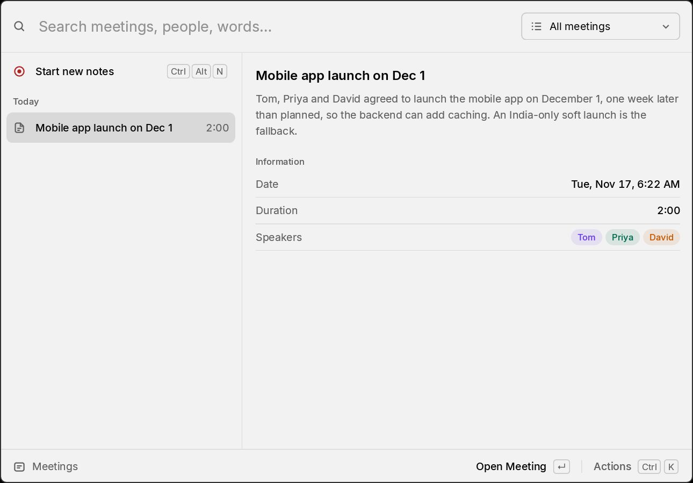
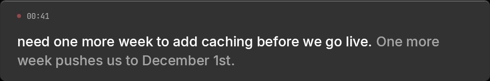
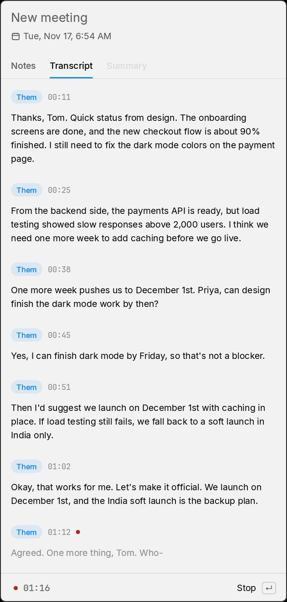
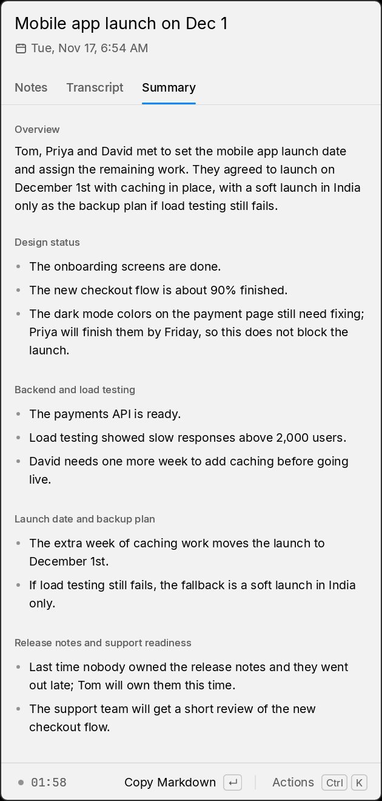
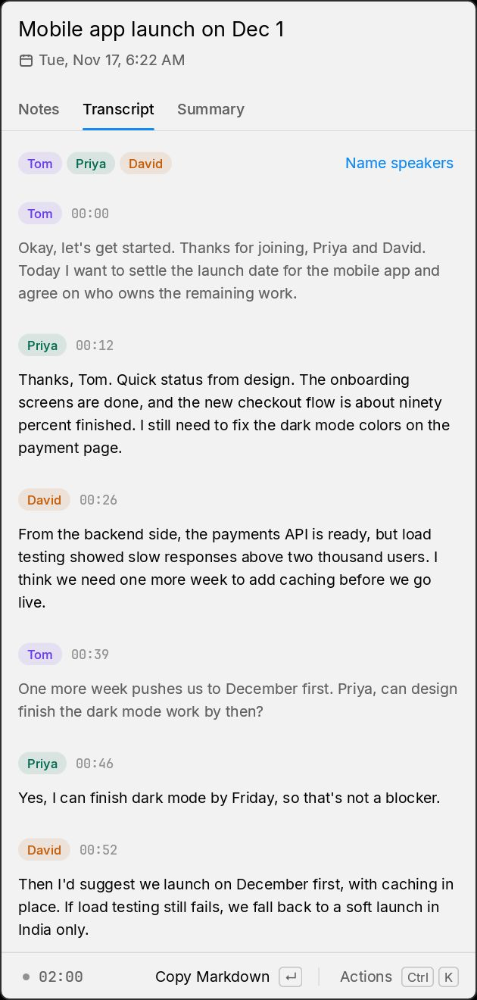
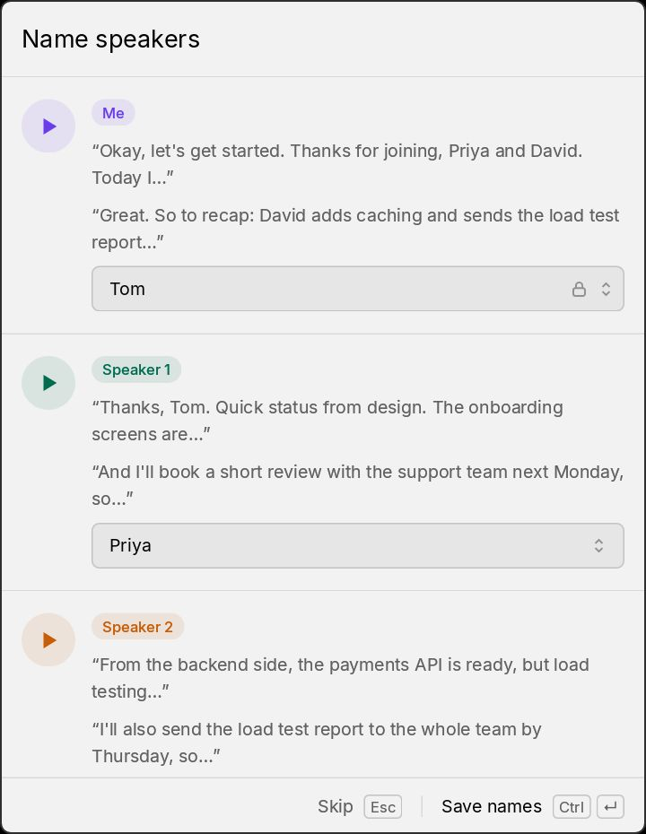
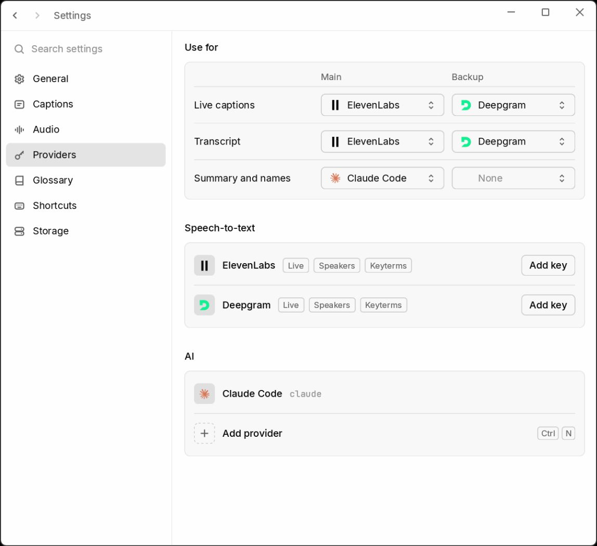

# Recap

Recap is a meeting notetaker for Windows. During a call it shows live captions of the other side in a small bar that stays on top. After you press Stop, it writes a clean transcript with speaker names, a summary, next steps with owners, and decisions.

It works with any call app (Teams, Zoom, Meet in a browser). Nothing joins the call. Recap records your mic and the meeting audio on your own PC.



## Screenshots

Live captions. Grey words may still change, and white words are final. Screen sharing doesn't show the bar.



| Live transcript | Summary | Transcript after Stop |
|---|---|---|
|  |  |  |

| Name speakers | Providers |
|---|---|
|  |  |

## Install

1. Run `recap_<version>_x64-setup.exe`. It installs for your user only and needs no admin rights. The build is unsigned, so SmartScreen may warn you. Choose More info, then Run anyway.
2. Open Settings with Ctrl+, and go to Providers. Add an ElevenLabs key for speech. For the summary, Recap uses the Claude Code CLI by default, or you can add Anthropic, any OpenAI-compatible API, or your own command. Press Test on each one.
3. In General, set your name. Recap uses it for your own lines.

Recap keeps meetings and settings in `%LOCALAPPDATA%\Recap`, and API keys in Windows Credential Manager. Uninstalling keeps both.

## Use

1. Start notes with Ctrl+Alt+N, from the tray icon, or with "Start new notes" in Home. Recap also suggests it when Teams or Zoom starts using your mic, but it never starts on its own.
2. Read the captions in the bar. The Notes window keeps the live transcript, and you can type your own notes there.
3. Press Stop (Enter). Recap transcribes the recording again, names the speakers, and writes the summary. You can close the window while it works.
4. Find old meetings in Home. Search covers titles, people, and anything said. Ctrl K opens actions such as Copy Markdown, Export, Name speakers, and Delete.

Each job (live captions, transcript, summary) has a main and a backup provider. If the main one fails on quota, key or network, Recap switches to the backup and tells you.

## Build from source

You need Windows, the MSVC toolchain, and CMake. The `opus` crate builds with CMake, which comes with the VS Build Tools "C++ CMake tools".

```
cargo run -p recap
cargo run -p recap -- --replay testdata/meeting_tts.wav
cargo test --workspace
```

`--replay` plays the test meeting through the app instead of your mic and speakers. It needs `ELEVENLABS_API_KEY` in the environment. `--scripted` replays the test meeting with built-in captions and needs no key. `--seed` adds the test meeting to Home.

To test the UI, run `zgx test` and `zgx lint .` in `crates/app/ui`.

To build the installer:

```
cargo install cargo-packager --version 0.11.8 --locked
cargo packager --release -p recap
```

The setup file lands in `<target>\release\recap_<version>_x64-setup.exe`. Run it with `/S` to install silently. The setup and the uninstaller close every running `recap.exe`, including dev builds.

## Long-run test

`recap --soak <minutes>` loops the test meeting with scripted captions, so it calls no API. Every minute it logs memory and handle counts to `soak.csv`. At the end it writes PASS or FAIL to `soak_result.txt`, and it exits with code 1 if memory or handles kept growing. Data goes to `%TEMP%\recap-soak` unless `RECAP_DATA` is set. Run it for 180 minutes on a release build before a release.

## Docs

- `docs/design/`: screens, design tokens and motion.
- `docs/adr/`: the decisions made while building it.
- `GLOSSARY.md`: the words the code uses.
- `CLAUDE.md`: rules for working on the repo.
